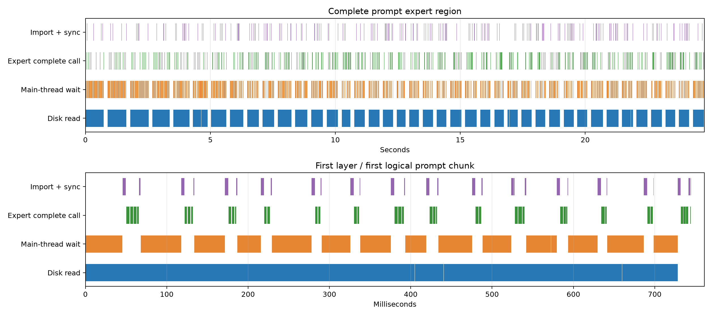

# MiniCPM-V 4.7 扩大专家缓存：约 5/6.5 GiB RSS

2026-10-21，RK3588，pp512/tg128，每档先测一次。

## 配置

- NFS 专家文件、O_DIRECT、每层动态 LRU、LES 开启、单 IO worker；调度策略没有修改。
- 同一无 SQ QQQ CT 模型：路由专家 gate/up/down 为 W4，共享专家和 LM head 为 W8。
- 同一 640 个真实文本 token IDs，context1024，物理 ubatch128。pp 不含最终输出头，tg 包含 LM head。
- CPU4–7、2.4 GHz；NPU mask7、1 GHz；DDR2112 MHz。模型加载和工作区准备不计入 pp/tg。
- 每层槽数固定为 20、40、64，内存目标只取近似值，没有通过额外运行精调 RSS。
- 峰值 RSS 包含约 121 MiB 的完整 logits 验证缓冲；另列 prefill 后 RSS。
- 三档使用本次同一个测速二进制；正式顺序为 40/64/20，64 槽 trace 单独运行，不计入正式速度。
- 测速入口接入已有 expert_slots 选项，runtime 缓存和预取策略保持一致。
- MoE W4 bank 最大分块由 32 MiB 降为 16 MiB，降低大块连续 IOVA 分配需求；专家记录格式和计算不变。

## 端到端

| 每层槽数 | 峰值 RSS GiB | pp 后 RSS GiB | pp512 秒 | pp tok/s | tg128 秒 | tg tok/s |
|---:|---:|---:|---:|---:|---:|---:|
| 20 | 3.709 | 3.578 | 23.751 | 21.557 | 63.219 | 2.025 |
| 40 | 4.969 | 4.836 | 24.021 | 21.315 | 44.752 | 2.860 |
| 64 | 6.481 | 6.349 | 23.402 | 21.878 | 32.775 | 3.905 |

## Decode 缓存、预测和 IO

| 每层槽数 | NPU 缓存命中 | 冷需求预测覆盖 | 冷需求提前完整就绪 | 缓存或预取已就绪 | 必要 MB/token | 实际 MB/token | 额外 MB/token | IO MB/s | 等待 ms/token |
|---:|---:|---:|---:|---:|---:|---:|---:|---:|---:|
| 20 | 57.58% | 70.41% | 5.93% | 60.10% | 216.84 | 227.36 | 10.52 | 484.3 | 308.6 |
| 40 | 71.85% | 66.59% | 10.26% | 74.74% | 143.91 | 159.13 | 15.23 | 505.9 | 175.5 |
| 64 | 82.51% | 60.89% | 13.38% | 84.85% | 89.42 | 106.70 | 17.28 | 525.9 | 95.2 |

## 与之前结果合并

| 模式 | 次数 | 每层槽数 | 峰值 RSS GiB | pp tok/s | tg tok/s | Decode 缓存命中 | 实际 MB/token |
|---|---:|---:|---:|---:|---:|---:|---:|
| 全专家驻留，历史 | 1 | 256 | 18.054 | 64.238 | 8.700 | — | 0.00 |
| eMMC，预取关，历史 | 2 | 20 | 3.685 | 11.874 | 1.022 | 57.52% | 217.13 |
| eMMC，预取开，历史 | 1 | 20 | 3.694 | 12.203 | 1.095 | 57.58% | 224.05 |
| 万兆 NFS，预取关，历史 | 2 | 20 | 3.702 | 21.916 | 1.967 | 57.52% | 217.13 |
| 万兆 NFS，预取开，历史 | 2 | 20 | 3.709 | 21.401 | 2.099 | 57.58% | 228.31 |
| 万兆 NFS，预取开，本次 | 1 | 20 | 3.709 | 21.557 | 2.025 | 57.58% | 227.36 |
| 万兆 NFS，预取开，本次 | 1 | 40 | 4.969 | 21.315 | 2.860 | 71.85% | 159.13 |
| 万兆 NFS，预取开，本次 | 1 | 64 | 6.481 | 21.878 | 3.905 | 82.51% | 106.70 |

历史结果按原样保留；本次三档使用相同新二进制和 16 MiB bank 分块，应优先用本次 20 槽作为容量变化的速度对照。全驻留缓存命中不按动态窗口计数，实际无需读盘。

冷需求预测覆盖含排队未开始的记录；提前完整就绪以实际需求入队时为界，记录在主机缓冲区，仍需导入 NPU。
额外读取=已完成读取字节−实际冷专家加载数×1,597,440 B，包含读完后取消的预取。MB 为十进制，GiB 为二进制。
所有档位冷启动 pp512 都从空缓存开始；读量见 summary.json。计算、IO 服务时间和主线程等待存在重叠，不能相加。

## 参数

当前 CLI 与测速入口使用 --expert-cache-percent，默认 8%；本模型对应每层 20 槽。15.625% 对应 40 槽，25% 对应 64 槽。历史证据保留当时的整数槽数命令和二进制。

```sh
target/release/examples/minicpmv47_bench \
  --model MODEL --text data/wiki.test.raw --storage stream \
  --expert-store EXPERT_STORE --expert-cache-percent 15.625 --report result.json
```

约 6.5 GiB 档将百分比改为 25。容量向下取整，至少保留 top-k，最多保留该层所有路由专家。

## 正确性与证据

完整原始 JSON、trace 和冻结二进制保留在本地实验目录，未随仓库发布。

- 三档完整 128 行 FP32 logits 均与既有常驻基线逐字节一致。
- 参数接入通过 fmt、全目标 Clippy 和现有 Rust 测试；bank 分块调整通过独立整数参考与物理槽位检查。
- 固定频率运行 exit_code=0、restore_errors=[]；原始样本、网络计数及调优计数保留在证据目录。
- 64 槽 trace 物理槽位检查 204800 次，违规 0。
- 源码快照、测速脚本和原始 JSON 位于 evidence/minicpmv47_cache_budget_20261021/。


