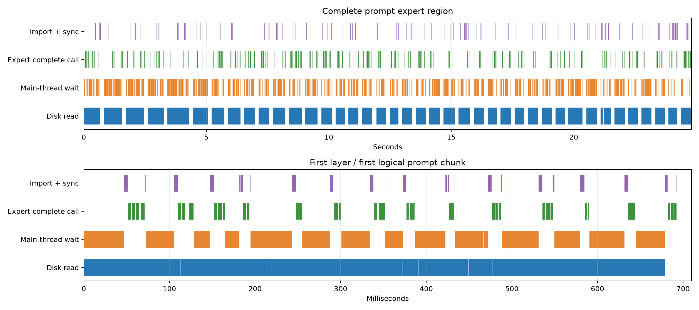

# MiniCPM-V 4.7 万兆 NFS 与 eMMC 对比

2026-10-21，RK3588，pp512/tg128，物理 ubatch 128，每层 20 个专家缓存槽。

## 测量范围

- 冻结本次板端已有的测速二进制，eMMC/NFS 使用同一文件；本次没有修改或重新编译 runtime、算子库。
- 板端二进制在上轮首个正式样本后重建过，因此因果比较以本次 eMMC 对照为准；上轮数据单列为历史参考。
- 同一无 SQ 模型、640 个真实文本 token IDs、量化配置、上下文 1024、CPU/NPU mask 与频率。
- 路由专家 gate/up/down 为 W4；共享专家和 LM head 为 W8。
- 非专家模型文件继续从 eMMC 加载；只有流式原生专家文件切换到 NFS，模型加载不计入 pp/tg。
- 板端网口为 10000 Mb/s，NFSv4.0 TCP，rsize/wsize 1 MiB。
- 原生专家记录使用 O_DIRECT，客户端页缓存不参与专家数据供给；服务器页缓存没有清理，新复制文件可能仍在服务器内存。
- pp 为无最终输出头的完整主干前向；tg 包含 LM head。各次使用独立进程和初始空专家窗口。
- 本次先测 eMMC 对照一次，再按 NFS 开/关/关/开顺序运行；trace 单独运行，不纳入正式均值。

## 端到端

| 配置 | 次数 | pp 秒 | pp tok/s | tg 秒 | tg tok/s | 峰值 RSS GiB |
|---|---:|---:|---:|---:|---:|---:|
| eMMC 历史，预取开 | 2 | 42.359 | 12.087 | 116.746 | 1.096 | 3.694 |
| eMMC 本次，预取开 | 1 | 41.958 | 12.203 | 116.900 | 1.095 | 3.694 |
| NFS 万兆，预取关 | 2 | 23.362 | 21.916 | 65.075 | 1.967 | 3.702 |
| NFS 万兆，预取开 | 2 | 23.925 | 21.401 | 60.978 | 2.099 | 3.709 |

## 专家 IO

| 配置 | pp GB | pp 读盘秒 | pp 等待秒 | pp MB/s | tg GB | tg 读盘秒 | tg 等待秒 | tg MB/s |
|---|---:|---:|---:|---:|---:|---:|---:|---:|
| eMMC 历史，预取开 | 10.380 | 36.341 | 29.585 | 285.629 | 28.677 | 113.672 | 94.039 | 252.281 |
| eMMC 本次，预取开 | 10.380 | 35.941 | 29.722 | 288.813 | 28.679 | 113.852 | 95.139 | 251.895 |
| NFS 万兆，预取关 | 10.380 | 17.303 | 9.998 | 599.897 | 27.792 | 50.270 | 43.971 | 552.856 |
| NFS 万兆，预取开 | 10.380 | 17.843 | 10.645 | 581.744 | 29.224 | 57.778 | 36.662 | 505.793 |

读取累计耗时、导入、计算和主线程等待存在重叠，不能相加。IO MB/s 为记录字节数除以读调用累计耗时。
原测速 JSON 的 io_* 字段在此内核上来自整块 eMMC，不能当作 NFS 流量；NFS 数据以 *.network.json 和 summary.json 的 nfs_process/nfs_sampled 字段为准。
nfs_process 覆盖整个命令，包含专家文件头和可能的后台读取；nfs_sampled 通过报告文件观察阶段，边界有最多约 50 ms 加文件系统延迟的采样偏差。

| NFS 样本 | 程序专家读取 GB | NFS direct-read GB | READ RPC 次数 | READ 重传次数 | 网口接收 GB |
|---|---:|---:|---:|---:|---:|
| nfs_on_0 | 39.544627 | 39.544627 | 47970 | 0 | 41.712 |
| nfs_off_0 | 38.172426 | 38.172426 | 46252 | 0 | 40.492 |
| nfs_off_1 | 38.172426 | 38.172426 | 46252 | 0 | 40.314 |
| nfs_on_1 | 39.662838 | 39.662838 | 48118 | 0 | 41.919 |

## 缓存与预测

| 配置 | tg 缓存命中 | LES 召回 | 冷需求预测覆盖 | 冷需求提前完整就绪 | 额外读 GB |
|---|---:|---:|---:|---:|---:|
| eMMC 历史，预取开 | 57.58% | 81.18% | 70.41% | 0.00% | 0.922 |
| eMMC 本次，预取开 | 57.58% | 81.18% | 70.41% | 0.00% | 0.923 |
| NFS 万兆，预取关 | 57.52% | — | 0.00% | 0.00% | 0.000 |
| NFS 万兆，预取开 | 57.58% | 81.18% | 70.41% | 7.58% | 1.468 |

冷需求预测覆盖包含排队但尚未开始的读取，与提前完整就绪不同。pp512 从空窗口一次汇总路由，初始持久窗口命中为 0%；复用体现在每层每专家只读一次。
额外读取按完成读取字节减去实际冷专家加载数乘以记录大小计算。原始 discarded_read_bytes 只计在途取消后丢弃的读取，不包含已读完、在 ready 队列中取消的记录，不能单独当作全部无效预取。
本次 trace 额外读取 908 条，其中已就绪后取消 187 条；两类取消之和与额外读取数一致。

## Decode 每 token 读取量

每条原生记录 1,597,440 B。40 层 × top-8 = 320 次路由专家使用/token。MB 按十进制计算。

| 项目 | 预取关 | 预取开 |
|---|---:|---:|
| 缓存命中专家数/token | 184.078 | 184.258 |
| 需加载专家数/token | 135.922 | 135.742 |
| 必要读取 MB/token | 217.127 | 216.840 |
| 额外读取 MB/token | 0.000 | 11.469 |
| 实际读取 MB/token | 217.127 | 228.309 |
| 读调用累计 ms/token | 392.737 | 451.388 |
| 主线程等待 IO ms/token | 343.524 | 286.418 |
| 端到端 ms/token | 508.399 | 476.390 |

必要读取和缓存命中均以每层每 token 的实际路由为准；同一专家跨 token 再次加载会再次计入。预取改变读取时机，本身不会消除这些必要字节。

## 缓存与预取的完整分支

以下为 NFS 预取开启两次正式运行的均值，每次 128 token，共 40,960 次实际专家需求。七行互斥且完整。

| 实际需求情况 | 每 128 token 次数 | 占全部需求 | 每 token 次数 |
|---|---:|---:|---:|
| 缓存中；LES 也预测中，直接使用 NPU 权重 | 20187 | 49.28% | 157.71 |
| 缓存中；LES 未预测中，直接使用 NPU 权重 | 3244 | 7.92% | 25.34 |
| 缓存中；第 0 层没有 LES，直接使用 NPU 权重 | 154 | 0.38% | 1.20 |
| 缓存未中；LES 预测中，预取已完整就绪 | 1317 | 3.22% | 10.29 |
| 缓存未中；LES 预测中，仍在排队或读取 | 10916 | 26.65% | 85.28 |
| 缓存未中；LES 未预测中，按需读取 | 4272 | 10.43% | 33.38 |
| 缓存未中；第 0 层没有 LES，按需读取 | 870 | 2.12% | 6.80 |

缓存命中 57.58%；在剩余冷需求中，预测覆盖 70.41%，提前完整就绪 7.58%。
缓存或预测覆盖 87.45%；需求到来时，缓存或预取记录已经就绪 60.80%。预取就绪指主机缓冲区已有完整记录，仍需要导入和同步到 NPU。
过滤已缓存专家后，共排入 17269 个预取候选，12233 个后来需要，队列候选正确率 70.84%；5036 个不需要，去向如下。

| 未使用预测的去向 | 每 128 token 次数 | 占未使用预测 |
|---|---:|---:|
| 尚未启动 IO 就取消 | 4117 | 81.75% |
| 已启动 IO，读取中取消 | 718 | 14.26% |
| 已读完，在 ready 队列中取消 | 201 | 3.99% |

单独 trace 样本中，以预取身份实际启动 IO 6269 次，其中 5361 次后来需要，正确率 85.52%。这与排入预测队列的分母不同。
尚未就绪包含仍排队和正在读取；正式样本的计数器没有进一步拆分两者。需求到来时未就绪也不一定导致完整等待，后续热专家计算期间仍可能完成读取。

## 原始存储读取

| 存储 | 访问模式 | GB | 秒 | MB/s |
|---|---|---:|---:|---:|
| emmc | sequential_64MiB | 2.147 | 9.312 | 230.6 |
| emmc | random_expert | 0.818 | 3.301 | 247.8 |
| nfs | sequential_64MiB | 2.147 | 3.120 | 688.2 |
| nfs | random_expert | 0.818 | 1.664 | 491.5 |

## Trace 与正确性

- pp 实际层/专家并集 6498，读取 6498 次，重复读取 0 次。
- pp trace 专家区域 24.808 s；读调用并集 18.841 s，专家完整调用 4.410 s，导入 1.928 s。
- 相邻层 routed 区域之间累计 4.821 s，与读盘重叠 0.000 s；该区间包含共享 FFN、下一层 mixer 和路由等工作。当前 prefill 没有下一层预测读取。
- pp 专家完整调用 1496 次，每次平均 109.52 个物理行，物理上限 128。
- 预测产生提前量均值 11.159 ms；实际预测读开始提前量 2.542 ms，读取用时 3.468 ms。
- 时序与物理槽位审计 204800 项，违规 0。
- 所有正式运行及 trace 的完整 128 行 FP32 logits 均与上轮常驻基线逐字节一致。
- 固定频率运行 exit_code=0，restore_errors=[]；完整调优计数保留在 summary.json，本次没有在线调优。

## 原始样本

| 样本 | pp 秒 | tg 秒 |
|---|---:|---:|
| emmc_on_0 | 41.957814 | 116.899653 |
| nfs_on_0 | 23.843265 | 61.271148 |
| nfs_off_0 | 23.384412 | 64.532951 |
| nfs_off_1 | 23.340272 | 65.617301 |
| nfs_on_1 | 24.005819 | 60.684687 |

完整原始数据与冻结二进制保留在本地实验目录，未随仓库发布。证据目录：evidence/minicpmv47_nfs10g_20261021/。
本次板端源码快照：evidence/minicpmv47_nfs10g_20261021/source_snapshot.tar.gz。

## 实际读序列的纯 IO 并发回放

取 trace 中前 4096 条 decode 专家记录，共 6.543 GB，每个配置读取相同记录集合。
固定频率、CPU4–7；客户端 O_DIRECT，服务器缓存未清理。顺序为 1/2/4/4/2/1。
每个 worker 复用一个预分配对齐缓冲区，不执行 NPU 导入、模型计算或真实路由依赖，因此是 IO 供给探针，不是端到端性能预测。

| worker 数 | 第一次 MB/s | 第二次 MB/s | 总字节/总时间 MB/s |
|---:|---:|---:|---:|
| 1 | 649.98 | 630.32 | 640.00 |
| 2 | 708.00 | 725.05 | 716.43 |
| 4 | 704.04 | 719.72 | 711.80 |

当前带模型 decode 的有效专家读取为 505.79 MB/s。纯 IO 单 worker 到双 worker 提高 11.9%，四 worker 没有继续提高。
按本次最佳纯 IO 716.43 MB/s，当前 228.31 MB/token 仅搬运就要 318.7 ms/token；必要冷读 216.84 MB/token 则要 302.7 ms/token。这些是 IO 时间下界，不能直接当作端到端速度。
当前读取耗时还包含请求处理、缓冲区准备、NFS/RPC 等成本；纯 IO 与带模型之间还存在内存分配及 CPU/内存争用等差异，本实验没有分别归因。实测约 0.7 GB/s 不是硬件绝对上限，也不足以证明只改队列就能翻倍。
