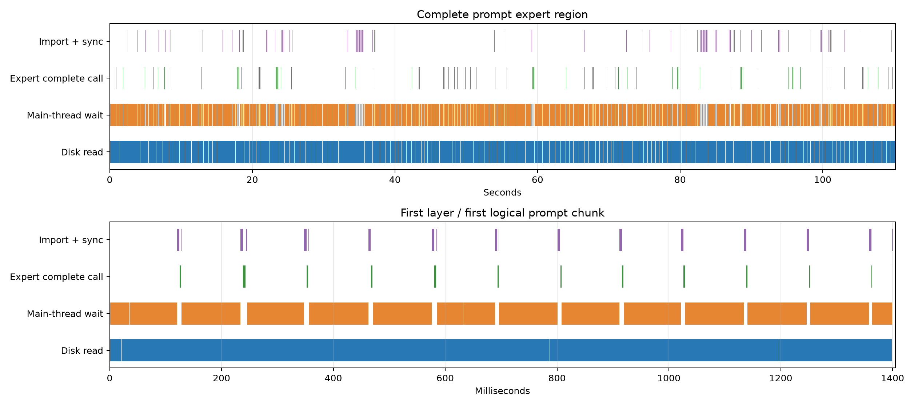
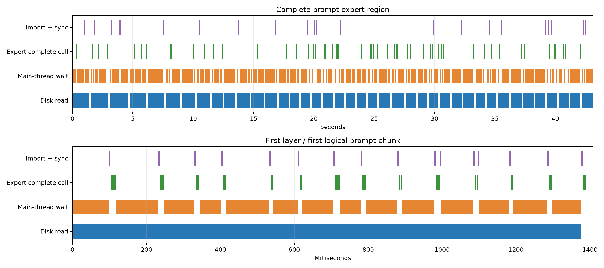

# MiniCPM-V 4.7 无 SQ：pp512/tg128 与流式专家调度

2026-10-21，RK3588。实测模型为 MiniCPM-V-4.7-35B-A3B-QQQ-W4A8-Mixed-CT。

移植后的 stream + LES：prefill 用时从 108.879 s 降到 42.359 s，吞吐提高 2.570 倍；decode 从 117.911 s 到 116.746 s。decode 的主要开销仍是 eMMC 专家读取。

## 测量范围

- 连续真实 WikiText 文本，512 个 prompt token 后接固定的 128 个 teacher-forced token，所有配置使用相同 640 个 token IDs。
- NPU 物理 ubatch 128，CPU 4 大核、mask 0xf0，NPU mask 7；CPU 2.4 GHz、NPU 1 GHz、DDR 2112 MHz。
- prefill 为完整主干前向，不计算最终 LM head；decode 每步包括 LM head，并包含 logits 检查与内存捕获开销。磁盘写出 logits 在计时后进行。
- 表中不含 tokenizer、模型加载、工作区准备和首次专家缓存准备。stream 热窗口每层 20 个专家，预取开关只控制预测读取。
- 权重与原生专家文件都在板端 eMMC；原生记录使用 O_DIRECT。路由专家 gate/up/down 都为 W4，共享专家与 LM head 为 W8。没有恢复自定义 SQ。
- 未调优：tune_calls=0、weight_reload_calls=0。常规 Linear 使用既有合法 fallback；原始 JSON 保留完整计数。

## 端到端前向

| 模式 | pp512 秒 | pp tok/s | tg128 秒 | tg tok/s | 峰值 RSS GiB |
|---|---:|---:|---:|---:|---:|
| 改前 resident | 8.250 | 62.060 | 14.725 | 8.692 | 18.065 |
| 改前 stream，预取关 | 108.872 | 4.703 | 129.914 | 0.985 | 3.637 |
| 改前 stream，预取开 | 108.879 | 4.702 | 117.911 | 1.086 | 3.637 |
| 移植后 resident | 7.970 | 64.238 | 14.713 | 8.700 | 18.054 |
| 移植后 stream，预取关 | 43.119 | 11.874 | 125.298 | 1.022 | 3.685 |
| 移植后 stream，预取开 | 42.359 | 12.087 | 116.746 | 1.096 | 3.694 |

改前每组 2 次；移植后 stream 每组 2 次，resident 1 次。新模型各组完整 128 行 FP32 logits 均与常驻基线逐字节一致；129-token 非整 ubatch 边界及 trace 运行也逐字节一致。
峰值 RSS 包含测速程序保留的完整 logits（约 121 MiB），设备 payload 与 RSS 的计量范围不同。

## 专家读取与等待

| 配置 | pp 读取 GB | pp 等待秒 | tg 读取 GB | tg 等待秒 | pp 读取 MB/s |
|---|---:|---:|---:|---:|---:|
| 改前 stream，关 | 26.021 | 93.425 | 28.083 | 107.162 | 253.8 |
| 改前 stream，开 | 26.021 | 93.471 | 28.955 | 94.968 | 253.6 |
| 移植后 stream，关 | 10.380 | 30.417 | 27.792 | 102.689 | 280.0 |
| 移植后 stream，开 | 10.380 | 29.585 | 28.677 | 94.039 | 285.6 |

读取量来自已完成的原生专家记录读取；板端内核没有 /proc/self/io，同时记录了整块 eMMC 的扇区计数。该块设备计数包含其他读取；原始结果可检查两者差值。读取累计耗时与主线程等待重叠，不能相加。

## 缓存和预取命中

| 配置 | prefill 持久窗口命中 | decode 持久窗口命中 | LES top-8 召回 | 冷需求预测覆盖 | 需求入队前完整就绪 |
|---|---:|---:|---:|---:|---:|
| 改前 stream，关 | 44.01% | 57.08% | — | — | — |
| 改前 stream，开 | 44.01% | 57.08% | 81.18% | 70.63% | 0.00% |
| 移植后 stream，关 | 0.00% | 57.52% | — | — | — |
| 移植后 stream，开 | 0.00% | 57.58% | 81.18% | 70.41% | 0.00% |

持久窗口命中指路由确定时已在该层 NPU 窗口中的 assignment。新 prefill 从空窗口开始，一次汇总整个逻辑 chunk 的路由，因此该项为 0%；同一已载入专家服务整个逻辑 chunk 的复用计入读取次数减少，不计为初始窗口命中。decode 两边的定义相同。
LES 召回分母为 39 层 × 128 token × top-8；冷需求预测覆盖指实际冷需求先前已排入预测队列，包含尚未开始读取的预测。完整提前就绪要求需求入队时读取已经结束，不能由预测正确率推断。

## 时序与 prefill 策略

- 改前：prefill 读 16289 条记录，其中重复读 9791 条（15.641 GB）。全 prompt 的层/专家并集为 6498。
- 改前：预测平均提前 22.268 ms，实际预测读平均提前 3.419 ms；单条预测读平均 6.355 ms。
- 移植后：prefill 读 6498 条记录，其中重复读 0 条（0.000 GB）。全 prompt 的层/专家并集为 6498。
- 移植后：预测平均提前 23.239 ms，实际预测读平均提前 2.618 ms；单条预测读平均 6.614 ms。

改前先跑一个 128-token ubatch 的全部 40 层，再跑下一个 ubatch；冷槽位在层间复用。相同层的冷专家到下一块时需重读。新路径在逻辑 chunk 内先按层处理物理 ubatch，再按专家并集读取和计算；物理 NPU 调用仍不超过 128 行。
trace 的预取队列会优先让当前层真实冷需求读完，预测虽早生成，实际 I/O 提前量短得多。0% 完整提前就绪时仍可有收益，因为需求到来时已有部分读取完成。每条错误预测读也会占用真实存储带宽。
时序图中 Expert complete call 包含专家完整调用；不是纯 NPU 硬件时钟。trace 时序窗口为首次实际 router 到末次 routed FFN，不包含第一段 mixer 和最终 shared FFN；表中端到端耗时来自正式无 trace 测量。

## 上游与实现

- [Strata](https://github.com/Niko1221/Strata/tree/cbfd5b926b794b356195d3cb600191b0c3567540)：逻辑 prompt chunk 内按层汇总、专家分组 staged walk，以及相邻记录批量读取。
- [llama.cpp-omni](https://github.com/OpenBMB/llama.cpp-omni/blob/a64932ec615e1463158129feaf2f0752d0c07a2e/src/llama-moe-slot.cpp)：每层持久 LRU、真实请求保护、预测集优先保护及 fallback 淘汰。
- Rust 控制流接入现有阻塞 NPU ABI。逻辑 prefill chunk 默认上限 1024；本次 prompt 实际为 512。MTP 目标捕获继续使用原有物理 chunk 路径；外部草稿的目标特征按原位置顺序提交。
- 相邻专家最多 8 条使用 preadv 直接读入已有对齐记录槽；不读未请求的间隙。I/O 仍为单个后台 worker，真实需求优先。上游 CUDA/Metal 异步提交及直接写入 GPU cache 的路径没有作为 RK NPU API 使用。
- 两份 MIT 许可保留在 src/model/experts/Strata-LICENSE 和 Omni-LICENSE；第三方说明记录了两个 revision。

常驻加载另将 W4 专家 bank 的单块分配限制到 32 MiB，解决板端 256 MiB 映射 IOVA -12。新格式加载复用现有 compressed-tensors 解包、拼接与 NPU 打包。

## 数据与复现

完整原始数据、trace 与冻结二进制保留在本地实验目录，未随仓库发布；下列目录用于本地复核。

- 旧结果与 trace：evidence/minicpmv47_nosq_20261021/。
- 新结果、trace、分析与脚本：evidence/minicpmv47_upstream_sched_20261021/。
- 测速入口：tests/tools/minicpmv47_bench.rs；分析入口：tests/tools/analyze_moe_stream.py。
- 79 项单元测试、Clippy -D warnings、W4 MoE 整数参考/物理槽位测试通过；所有固定频率运行 restore_errors 为空。
- 板端旧 SQ 模型与旧原生缓存已清理；保留新的 19.66 GB 模型及 16.36 GB v2 专家缓存。

### 原始样本

| 版本/样本 | pp 秒 | tg 秒 |
|---|---:|---:|
| before/resident_0 | 8.463413 | 14.761135 |
| before/resident_1 | 8.036761 | 14.689731 |
| before/stream_off_0 | 108.953749 | 129.714089 |
| before/stream_off_1 | 108.790472 | 130.114547 |
| before/stream_on_0 | 108.513805 | 117.971322 |
| before/stream_on_1 | 109.243950 | 117.851329 |
| after/resident_0 | 7.970386 | 14.713142 |
| after/stream_off_0 | 43.921983 | 125.324762 |
| after/stream_off_1 | 42.315354 | 125.270588 |
| after/stream_on_0 | 42.406447 | 116.665849 |
| after/stream_on_1 | 42.312287 | 116.825983 |

### 每层路由与读取

旧列的 unique 是每个 128-token ubatch 平均值；新列是整段 512-token 逻辑 chunk 的专家并集。

| 层 | 旧 unique/ubatch | 新 unique/prompt | 旧 pp 冷读 GB | 新 pp 冷读 GB | 旧 tg 热命中 | 新 tg 热命中 |
|---:|---:|---:|---:|---:|---:|---:|
| 0 | 190.75 | 225 | 1.1230 | 0.3594 | 26.86% | 15.04% |
| 1 | 204.25 | 239 | 1.2093 | 0.3818 | 25.78% | 21.58% |
| 2 | 212.50 | 252 | 1.2620 | 0.4026 | 29.10% | 26.56% |
| 3 | 184.00 | 235 | 1.0799 | 0.3754 | 45.61% | 39.06% |
| 4 | 167.00 | 221 | 0.9712 | 0.3530 | 46.48% | 40.04% |
| 5 | 137.25 | 198 | 0.7811 | 0.3163 | 51.86% | 50.59% |
| 6 | 128.75 | 189 | 0.7268 | 0.3019 | 50.39% | 54.98% |
| 7 | 123.25 | 180 | 0.6917 | 0.2875 | 63.38% | 64.84% |
| 8 | 87.75 | 145 | 0.4649 | 0.2316 | 74.71% | 76.37% |
| 9 | 102.50 | 153 | 0.5591 | 0.2444 | 67.77% | 66.21% |
| 10 | 130.25 | 174 | 0.7364 | 0.2780 | 50.00% | 51.17% |
| 11 | 134.50 | 179 | 0.7652 | 0.2859 | 45.80% | 48.93% |
| 12 | 104.50 | 164 | 0.5719 | 0.2620 | 66.70% | 64.55% |
| 13 | 101.00 | 150 | 0.5495 | 0.2396 | 66.99% | 70.02% |
| 14 | 82.00 | 122 | 0.4281 | 0.1949 | 68.46% | 72.46% |
| 15 | 90.50 | 137 | 0.4824 | 0.2188 | 66.21% | 70.70% |
| 16 | 95.25 | 135 | 0.5144 | 0.2157 | 62.21% | 68.95% |
| 17 | 100.25 | 144 | 0.5447 | 0.2300 | 63.77% | 68.46% |
| 18 | 89.00 | 126 | 0.4744 | 0.2013 | 61.62% | 67.58% |
| 19 | 87.75 | 135 | 0.4649 | 0.2157 | 66.89% | 73.05% |
| 20 | 81.50 | 135 | 0.4249 | 0.2157 | 75.29% | 78.22% |
| 21 | 96.50 | 142 | 0.5240 | 0.2268 | 65.72% | 66.31% |
| 22 | 117.75 | 161 | 0.6565 | 0.2572 | 51.95% | 54.98% |
| 23 | 134.00 | 185 | 0.7604 | 0.2955 | 46.19% | 50.20% |
| 24 | 92.50 | 144 | 0.4984 | 0.2300 | 67.09% | 65.14% |
| 25 | 91.25 | 134 | 0.4872 | 0.2141 | 64.06% | 68.75% |
| 26 | 91.25 | 139 | 0.4872 | 0.2220 | 64.06% | 65.82% |
| 27 | 94.25 | 138 | 0.5064 | 0.2204 | 64.16% | 64.65% |
| 28 | 102.25 | 150 | 0.5575 | 0.2396 | 63.77% | 66.11% |
| 29 | 104.50 | 155 | 0.5719 | 0.2476 | 60.25% | 62.11% |
| 30 | 100.25 | 141 | 0.5447 | 0.2252 | 59.86% | 64.84% |
| 31 | 87.00 | 129 | 0.4601 | 0.2061 | 66.11% | 68.36% |
| 32 | 116.75 | 161 | 0.6502 | 0.2572 | 55.37% | 54.69% |
| 33 | 125.25 | 170 | 0.7045 | 0.2716 | 47.27% | 45.41% |
| 34 | 127.25 | 161 | 0.7173 | 0.2572 | 50.98% | 47.27% |
| 35 | 105.00 | 150 | 0.5751 | 0.2396 | 59.86% | 61.72% |
| 36 | 115.00 | 154 | 0.6390 | 0.2460 | 54.59% | 49.41% |
| 37 | 112.50 | 144 | 0.6230 | 0.2300 | 49.80% | 51.27% |
| 38 | 106.25 | 147 | 0.5831 | 0.2348 | 62.40% | 59.67% |
| 39 | 116.50 | 155 | 0.6486 | 0.2476 | 53.81% | 47.17% |
